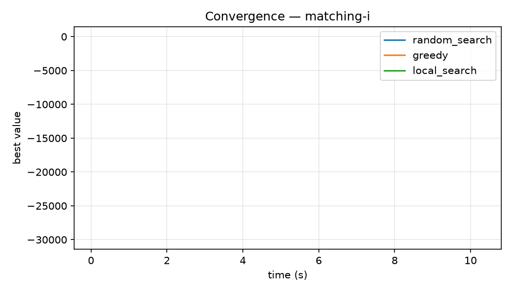
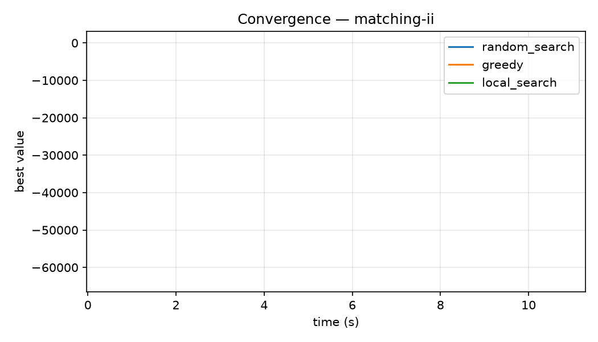
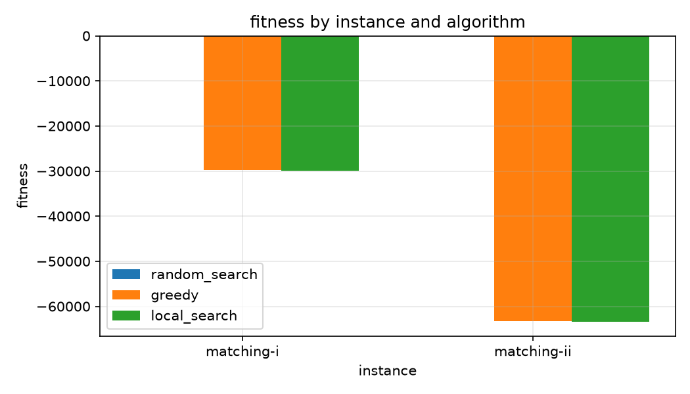
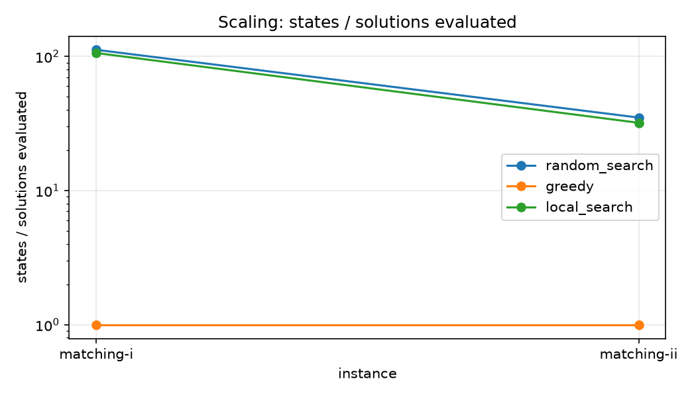
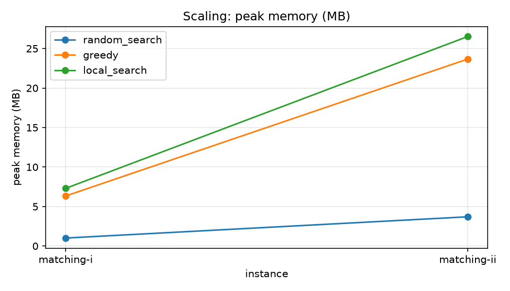
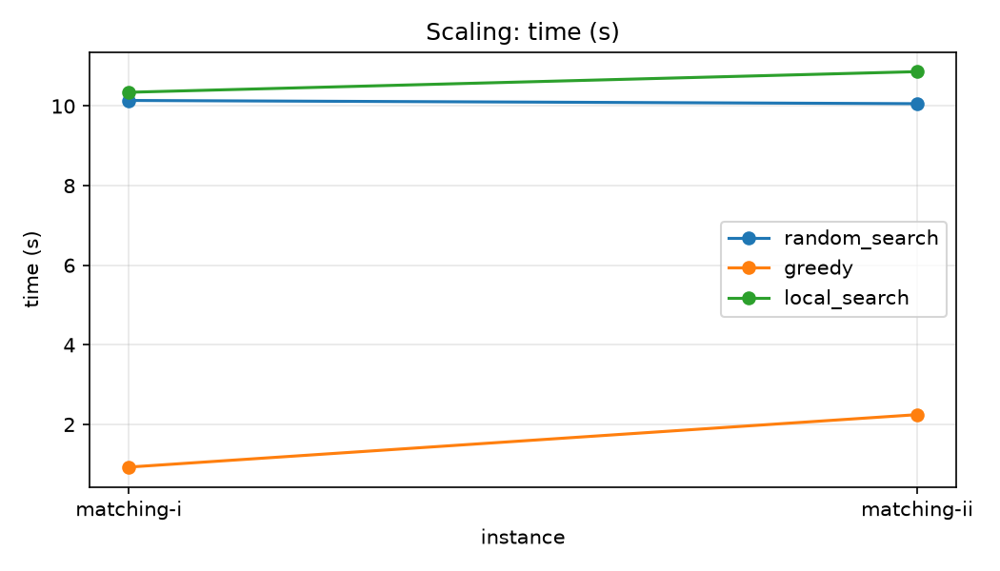

# Luna Tomato Logistics

Algorithm Design & Analysis project, built with [VSI](https://github.com/andikuqi/vsi).
Problem statement: [docs/PROBLEM.md](docs/PROBLEM.md) · Source: https://optimise.esa.int/challenge/spoc-4-luna-tomato-logistics/About

<!-- vsi:status:start -->
**Progress / Progresi:** `█████████████░░░ 78%  (18/23)`


## Quick start
```
python tasks.py start     # everything at once: data, tests, baseline, charts, report, progress
python tasks.py check     # progress + next step
```

## Report

### 1. Problem definition

Projekti trajton sfidën **ESA SpOC 4 – Luna Tomato Logistics**. Në pjesët *Matching I* dhe *Matching II*, çdo transfer përshkruhet nga katër vlera `(e, l, d, w)`: orbita e Tokës, orbita e Hënës, destinacioni në Hënë dhe pesha e transportuar. Qëllimi është të zgjidhet një grup transferesh me **peshën totale maksimale**, duke respektuar kushtin që secila orbitë `e`, `l` dhe secili destinacion `d` përdoret maksimumi një herë.

Për `n` transfere përdoret vektori binar `x` me `n` pozicione: `x[i] = 1` nëse transferi `i` zgjidhet, ndryshe `0`. Funksioni objektiv është `max Σ(w[i]·x[i])`, nën kufizimet e mospërsëritjes së `e`, `l` dhe `d`. Vlerësuesi zyrtar i ESA-s raporton **negativin e peshës së transportuar**, ndaj vlera më negative e `fitness` është më e mirë. Zgjidhjet me konflikte nuk marrin rezultat të vlefshëm.

Instancat e përdorura janë **Matching I (25,000 transfere)** dhe **Matching II (92,103 transfere)**. *Trajectory Matching* është problem tjetër, më i avancuar: kërkon planifikim fizik të trajektoreve Tokë–Hënë dhe nuk zgjidhet vetëm me zgjedhje të transfereve nga një listë.

### 2. Complexity of the problem

Problemi i përputhjes tredimensionale me peshë maksimale (*maximum-weight 3-dimensional matching*) është **NP-hard**. Për ta kuptuar, merrni problemin klasik *3-dimensional matching*: a mund të zgjidhen të paktën `K` treshe që nuk ndajnë asnjë element? Nëse çdo treshe merr peshën `1`, atëherë një algoritëm që gjen optimumin e problemit tonë do të na tregonte nëse ai optimum është të paktën `K`. Kjo redukton problemin klasik te varianti me peshë.

Për instanca kaq të mëdha, kërkimi i të gjitha kombinimeve nuk është praktik. Prandaj kemi përdorur **heuristika** që ndërtojnë shpejt një zgjidhje të vlefshme (Greedy) dhe pastaj e përmirësojnë atë (Local Search). Këto metoda **nuk garantojnë optimumin global**.

### 3. Data structures

- **Lista e transfereve:** çdo rresht `(e, l, d, w)` ruan të dhënat e një kandidati.
- **Bashkësitë (`set`) e nyjeve të përdorura:** lejojnë kontroll të shpejtë të konflikteve për `e`, `l`, `d`.
- **Vektori binar i zgjidhjes:** shënon cilat transfere përzgjidhen dhe përdoret për vlerësimin/dorëzimin sipas formatit të ESA-s.
- **Lista e shkurtuar e kandidatëve:** Local Search përdor më së shumti `k = 35` kandidatë për transfer të bllokuar për të kufizuar koston e kërkimit.
- **Skedarët `results/metrics.csv` dhe `results/upper_bounds.csv`:** ruajnë matjet dhe kufijtë e llogaritur për krahasim.

### 4. Algorithms

#### 4.1 Random Search — baseline nga VSI

Gjeneron vektorë rastësorë, i vlerëson me `udp.fitness()` dhe ruan më të mirin brenda buxhetit kohor. Kjo metodë shërben si pikë reference, por në instancat e mëdha shumë vektorë të rastësishëm shkelin kufizimet.

```text
best = asnjë
përderisa ka kohë:
    x = vektor rastësor
    f = fitness(x)
    nëse f është më i mirë se best: ruaj x
kthe best
```

Për `q` kandidatë dhe `n` pozicione: afërsisht **`O(q·n)` kohë**, nëse një vlerësim kushton `O(n)`; **`O(n)` hapësirë** për kandidatin dhe zgjidhjen më të mirë.

#### 4.2 Greedy — `src/algorithms.py`

Rendit transferet sipas peshës në rend zbritës dhe pranon një transfer vetëm kur `e`, `l`, `d` nuk janë përdorur më parë.

```text
rendit transferet nga pesha më e madhe te më e vogla
used_E, used_L, used_D = bashkësi boshe
për çdo transfer t:
    nëse pesha(t) > 0 dhe e/l/d e tij nuk janë përdorur:
        zgjidh t dhe shëno e/l/d si të përdorura
kthe zgjidhjen
```

**Koha: `O(n log n)`** për renditjen; **hapësira: `O(n)`** për indeksat dhe strukturat ndihmëse. Greedy garanton vlefshmërinë e kombinimit, jo optimalitetin.

#### 4.3 Local Search (zëvendësim 1-me-2) — `src/algorithms.py`

Niset nga zgjidhja Greedy. Kërkon raste ku heqja e një transferi dhe shtimi i dy transfereve të pajtueshme rrit peshën totale. Përdor **listë të shkurtuar prej 35 kandidatëve** dhe buxhet kohor për të mos e bërë kërkimin tepër të kushtueshëm.

```text
S = Greedy(transfers)
përderisa ka kohë:
    gjej një transfer të S që mund të zëvendësohet
    kërko dy transfere pa konflikte me peshë totale më të madhe
    nëse ka përmirësim: zëvendëso transferin në S
    përndryshe: ndalo
plotëso S me transfere pozitive që nuk kanë konflikt
kthe S
```

Në modelin e analizës së përdorur këtu, me `r` raunde, `s` transfere të zgjedhura dhe `k=35` kandidatë: afërsisht **`O(r·(n log n + s·k²))` kohë** dhe **`O(n+s)` hapësirë**. Ky është vlerësim sipas organizimit të kërkimit; koha reale ndikohet edhe nga kufiri prej rreth 10 sekondash. Nuk ka garanci për optimum global.

### 5. Search-space reduction / optimisations

Optimizimi kryesor është **kontrolli i menjëhershëm i konflikteve** me bashkësi, që eliminon kombinimet ku përsëritet `e`, `l` ose `d`. Greedy kufizon kërkimin te një zgjidhje fillestare e vlefshme. Local Search eksploron vetëm zëvendësime të kufizuara 1-me-2, me shortlist `k=35` dhe afat ekzekutimi.

Për krahasim përdoret edhe **Upper Bound** (`src/upper_bound.py`): për secilin grup `E`, `L` dhe `D`, mblidhen peshat maksimale të lidhura me çdo nyje; minimumi i tri shumave është kufi i sipërm i sigurt për optimumin. Llogaritja është **`O(n)` kohë** dhe **`O(v)` hapësirë**, ku `v` është numri i nyjeve të ndryshme. Ky kufi mund të jetë i lirshëm dhe **nuk është vetë zgjidhje**.

### 6. Experimental methodology

- **Të dhënat:** instancat zyrtare ESA, Matching I (25,000 transfere) dhe Matching II (92,103 transfere).
- **Mjedisi:** Windows, Python; testimet Advanced u ekzekutuan në mjedisin Conda `luna-esa` me Python 3.11. **CPU dhe RAM i laptopit duhen shtuar pas kontrollit të specifikave.**
- **Algoritmet e krahasuara:** Random Search (baseline), Greedy dhe Local Search.
- **Konfigurimi fillestar:** `src/run.py` përdor `--seed 0` dhe buxhet standard `--budget 10.0` sekonda për algoritëm/instancë. Greedy mund të përfundojë përpara këtij afati.
- **Matjet:** `fitness`, koha në sekonda, memoria maksimale, numri i vlerësimeve dhe numri i kandidatëve të anashkaluar; regjistrohen në `results/metrics.csv`.
- **Verifikimi:** `python tasks.py test` kontrollon testet; për Matching I dhe II zgjidhjet janë kontrolluar lokalisht me `udp.fitness()` të ESA-s. **Dorëzimi online nuk është konfirmuar.**
- **Kufizimi i eksperimentit:** rezultatet e raportuara janë nga një konfigurim ekzekutimi; për pohime më të forta statistike duhen prova të përsëritura me disa `seed`, madhësi dhe buxhete kohore.

Eksperimentet u realizuan në një kompjuter me sistem operativ Windows, procesor Intel Core i7-1355U (gjenerata e 13-të) dhe 15.7 GB RAM.

Për testimet fillestare të algoritmeve Greedy dhe Local Search u përdor Python 3.12.10. Për Trajectory Matching u krijua një mjedis i veçantë Conda me Python 3.11.18 dhe bibliotekat e nevojshme për simulimin orbital.

Algoritmet u testuan me dataset-et zyrtare Matching I (25,000 transfere) dhe Matching II (92,103 transfere). U matën koha e ekzekutimit, përdorimi maksimal i memories, numri i vlerësimeve dhe cilësia e zgjidhjeve.

Rezultatet u ruajtën në results/metrics.csv, ndërsa grafikat u gjeneruan për krahasimin e performancës.
### 7. Results
<!-- The block below is filled automatically by `python tasks.py report` (or `start`). Write your analysis after it. -->
<!-- vsi:results:start -->
_Generated by VSI on 2026-11-22 from `results/metrics.csv`._

| instance | algorithm | seconds | peak_mb | evaluated | pruned | pruned_pct | fitness |
|---|---|---|---|---|---|---|---|
| matching-i | random_search | 10.14 | 1.011 | 112 | 0 | 0 | 0 |
| matching-i | greedy | 0.9283 | 6.338 | 1 | 0 | 0 | -2.979e+04 |
| matching-i | local_search | 10.35 | 7.302 | 106 | 0 | 0 | -2.993e+04 |
| matching-ii | random_search | 10.06 | 3.7 | 35 | 0 | 0 | 0 |
| matching-ii | greedy | 2.246 | 23.67 | 1 | 0 | 0 | -6.331e+04 |
| matching-ii | local_search | 10.87 | 26.52 | 32 | 0 | 0 | -6.339e+04 |







<!-- vsi:results:end -->

### 8. Comparison & scalability (theory vs measured)

Eksperimentet u kryen mbi dy instancat zyrtare: Matching I (25,000 transfere) dhe Matching II (92,103 transfere). Matjet e mëposhtme vijnë nga `results/metrics.csv`; vlerat e transportit janë `-fitness`, sepse vlerësuesi i ESA-s kthen vlera negative për zgjidhjet më të mira.

| Instanca | Algoritmi | Pesha e transportuar | Koha (s) | Memoria maksimale (MB) |
|---|---|---:|---:|---:|
| Matching I | Greedy | 29,791.692 | 0.9283 | 6.338 |
| Matching I | Local Search | 29,928.278 | 10.3467 | 7.302 |
| Matching II | Greedy | 63,313.022 | 2.2459 | 23.670 |
| Matching II | Local Search | 63,392.117 | 10.8651 | 26.524 |

Local Search e përmirësoi peshën e transportuar me **136.586 (rreth 0.46%)** në Matching I dhe **79.095 (rreth 0.12%)** në Matching II. Ky përmirësim erdhi me kosto më të lartë kohore: Local Search përdori rreth 10 sekonda për instancë, ndërsa Greedy përfundoi më shpejt.

Teoria parashikon për Greedy kompleksitet kohor `O(n log n)` për renditjen e transfereve dhe `O(n)` hapësirë. Në matjet tona, numri i transfereve u rrit rreth 3.68 herë nga Matching I në Matching II, ndërsa koha e Greedy u rrit nga 0.9283 në 2.2459 sekonda. Këto dy matje janë në përputhje me rritjen e kostos kur zmadhohet hyrja, por **nuk provojnë vetë** kompleksitetin asimptotik: për një analizë më të besueshme duhen më shumë madhësi instancash dhe përsëritje.

Local Search nis nga Greedy, kërkon zëvendësime 1-me-2 dhe përdor një shortlist prej 35 kandidatësh me kufi kohor. Për këtë arsye, koha e matur afër 10 sekondave pasqyron kryesisht **buxhetin e ekzekutimit**, jo domosdoshmërisht mënyrën si rritet kompleksiteti me `n`. Grafikët `scaling_seconds.png`, `scaling_peak_mb.png` dhe `convergence_matching-i/ii.png` paraqesin matjet dhe ecurinë e algoritmeve.

### 9. Limitations & future work

- **Nuk ka garanci optimumi:** Greedy dhe Local Search janë heuristika. Upper Bound tregon një kufi teorik, por diferenca prej 27.99% (Matching I) dhe 28.98% (Matching II) nuk është provë se zgjidhjet janë po aq larg optimumit.
- **Përmirësim modest:** Local Search përmirësoi Greedy vetëm rreth 0.46% dhe 0.12%; për rezultate më konkurruese duhen eksploruar metoda të tjera dhe parametra të ndryshëm.
- **Eksperimentet janë të kufizuara:** Rezultatet aktuale vijnë nga një konfigurim testimi. Nevojiten disa ekzekutime me farëra rastësore dhe buxhete kohore të ndryshme, si edhe madhësi të tjera hyrjeje.
- **Trajectory Matching ende nuk është zgjidhur:** Përpjekjet e deritanishme prodhuan vlerësim ESA `0.0`. Ende nuk kemi një transfer Tokë–Hënë që përputh orbitën e synuar dhe kufizimet e masës/karburantit.
- **Dorëzimi në ESA mbetet i hapur:** Zgjidhjet për Matching I/II u kontrolluan lokalisht me vlerësuesin zyrtar, por llogaria e platformës ende nuk është funksionale; nuk kemi një pozicion të konfirmuar në Combined Leaderboard.

Puna e ardhshme duhet të fokusohet në optimizim më të fortë për Matching I/II, optimizim të plotë të trajektores dhe dokumentimin e eksperimenteve të përsëritura, përpara se të pretendohet një rezultat konkurrues në renditjen e kombinuar.

### Advanced Trajectory Matching — Verified result

We implemented a trajectory search using initial trajectory
estimates, mid-course corrections, and numerical refinement.

The best verified candidate achieved:
- Official ESA fitness: -194.04892254026709
- Total delta-v: 6022.4 m/s
- Transfer duration: 3 days
- Arrival position error: approximately 0 km

The final solution was independently evaluated with the
official ESA fitness function and saved as:
results/best_trajectory-matching.json

This confirms one valid Advanced delivery, but does not
establish a leaderboard ranking.
### 10. Conclusions
Në këtë projekt u implementuan dhe u krahasuan algoritmet Random Search, Greedy dhe Local Search për problemin Luna Tomato Logistics të ESA-s.

Local Search arriti rezultate më të mira se Greedy në të dy instancat: 29,928.278 në Matching I dhe 63,392.117 në Matching II.

Rezultatet tregojnë se kërkimi lokal përmirëson cilësinë e zgjidhjes, por kërkon më shumë kohë ekzekutimi. Pjesa Advanced mbetet për optimizim të mëtejshëm, pasi ende nuk është arritur transfer i vlefshëm.
### Tools used

- **VSI** ([GitHub](https://github.com/andikuqi/vsi)): struktura e projektit, shkarkimi i të dhënave zyrtare, baseline Random Search, matjet, krijimi i grafikave dhe skeleti i raportit.
- **Puna në projekt:** implementimi dhe testimi i parser-it, kontrollit të konflikteve, Greedy, Local Search me shortlist dhe Upper Bound; analiza e matjeve dhe dokumentimi. Këto pjesë janë zhvilluar me asistencën e AI dhe duhen kuptuar para mbrojtjes.
- **ChatGPT:** asistencë për kodimin, identifikimin e gabimeve, testet, analizën dhe hartimin e dokumentimit.
- **ESA Optimise:** të dhënat dhe vlerësuesit zyrtarë; rezultatet e Matching I/II janë verifikuar lokalisht, ndërsa llogaria/dorëzimi në platformë mbetet i pazgjidhur.

### References

- [ESA Optimise — SpOC 4: Luna Tomato Logistics](https://optimise.esa.int/challenge/spoc-4-luna-tomato-logistics/About)
- [ESA SpOC 4 — repository zyrtar](https://github.com/esa/SpOC4)
- [VSI — struktura ndihmëse e projektit](https://github.com/andikuqi/vsi)
