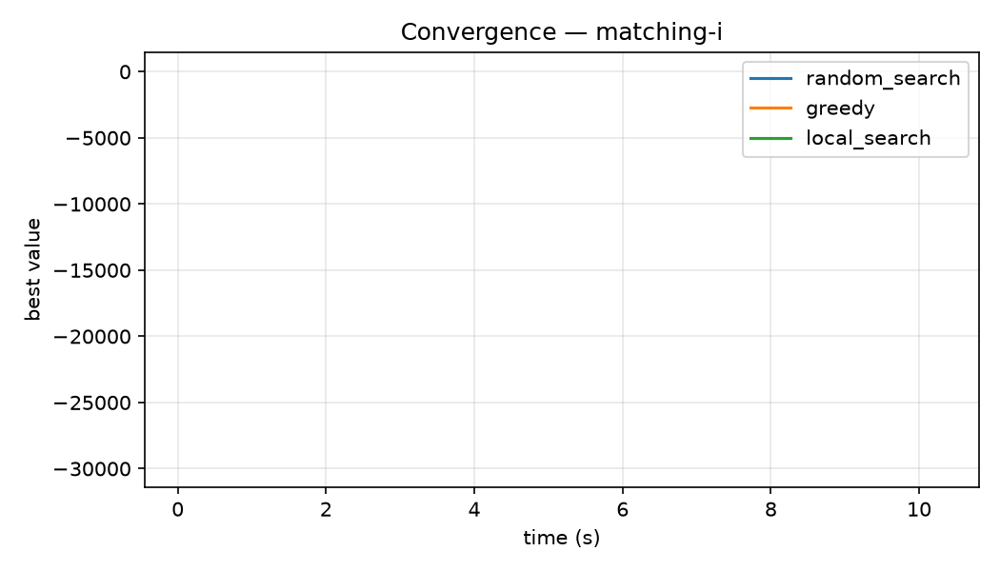
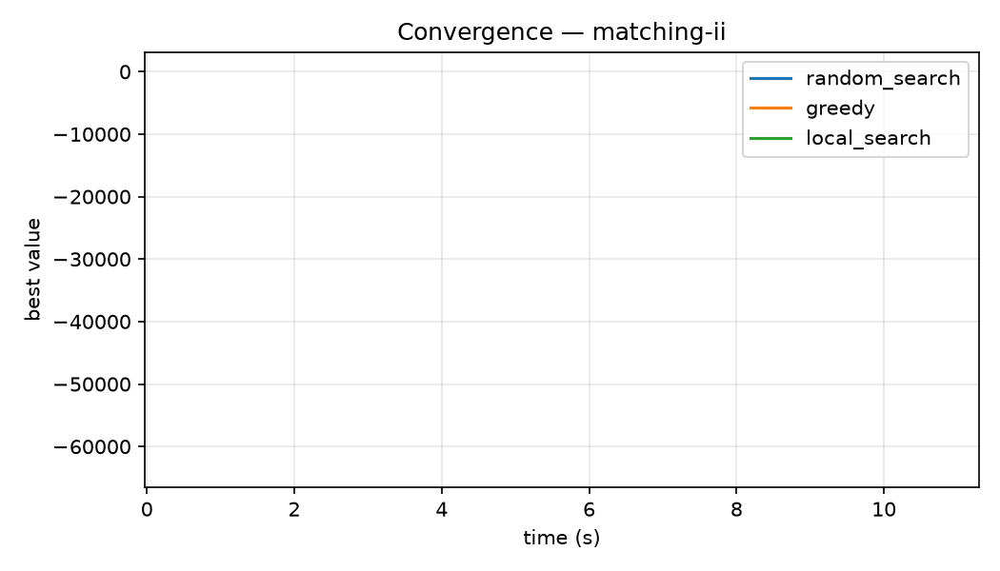
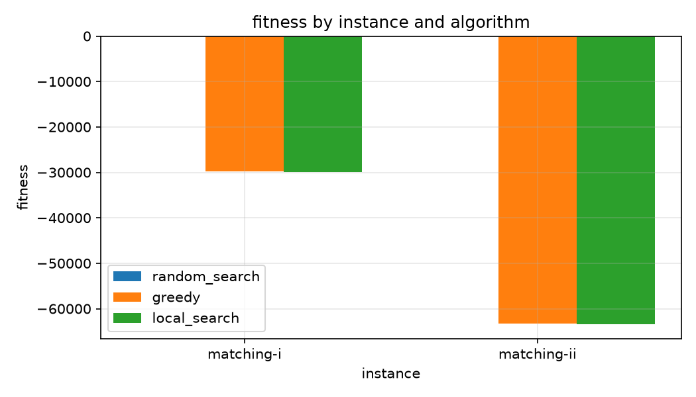
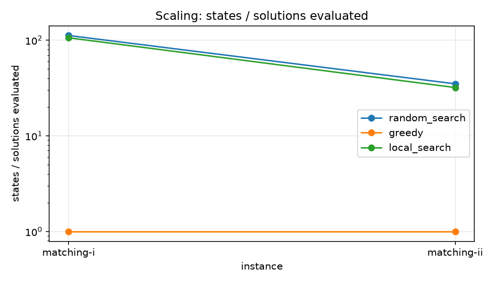
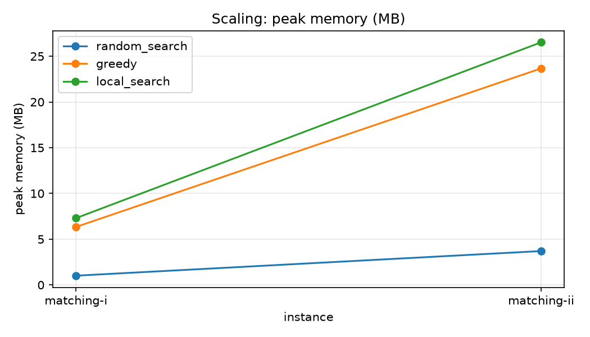
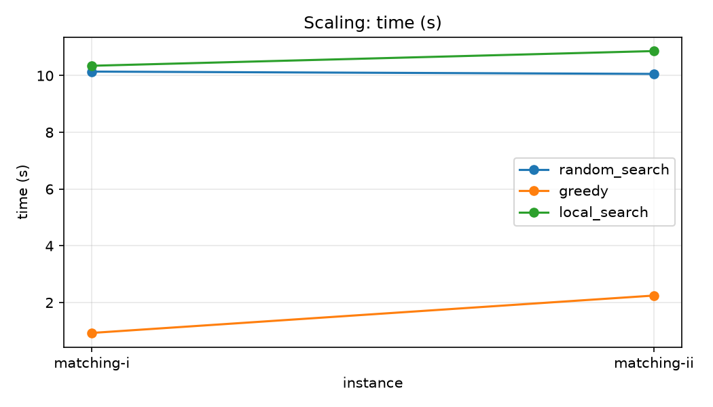

# Luna Tomato Logistics

Algorithm Design & Analysis project, built with [VSI](https://github.com/andikuqi/vsi).
Problem statement: [docs/PROBLEM.md](docs/PROBLEM.md) · Source: https://optimise.esa.int/challenge/spoc-4-luna-tomato-logistics/About

<!-- vsi:status:start -->
**Progress / Progresi:** `██████████░░░░░░ 65%  (15/23)`  
**Next step / Hapi i radhës:** (Optional) Advanced trajectory-matching problem
<!-- vsi:status:end -->

## Quick start
```
python tasks.py start     # everything at once: data, tests, baseline, charts, report, progress
python tasks.py check     # progress + next step
```

## Report

### 1. Problem definition

Luna Tomato Logistics është sfidë optimizimi e ESA-s. Në nënproblemet **Matching I** dhe **Matching II**, hyrja përbëhet nga transfere `(e, l, d, w)`, ku `e` është orbita e Tokës, `l` orbita e Hënës, `d` destinacioni dhe `w` pesha e ngarkesës. Dalja është një grup transferesh ku asnjë `e`, `l` apo `d` nuk përsëritet. Qëllimi është të **maksimizohet shuma e peshave** të transfereve të zgjedhura.

Zgjidhja paraqitet si vektor binar, një vlerë për çdo transfer. Vlerësuesi zyrtar ESA e kthen shumën me shenjë negative për minimizim, prandaj **një fitness më negativ është më i mirë**, ndërsa zgjidhjet e pavlefshme marrin rezultat zero. Në `docs/PROBLEM.md` ndodhet përshkrimi më i gjerë i sfidës; diagramet ndodhen në `docs/DIAGRAMS.md`.

### 2. Complexity of the problem

Matching I dhe II janë variante të **maximum-weight 3-dimensional matching**, një problem **NP-hard**. Problemi klasik 3-dimensional matching është NP-complete; duke vendosur peshë 1 për çdo triple, vendimi nëse ekziston zgjidhje me peshë të paktën `K` e përfshin problemin klasik. Kjo është arsyeja pse për instanca të mëdha përdorim heuristika dhe kufij teorikë, në vend që të kërkojmë në mënyrë shteruese të gjitha kombinimet.

Kjo vështirësi i referohet pjesës kombinatorike. **Trajectory Matching** është një problem tjetër, me kufizime fizike dhe trajektore, të cilin ende nuk e kemi zgjidhur. Referencë bazë për problemin klasik: R. M. Karp, *Reducibility Among Combinatorial Problems* (1972).

### 3. Data structures

- **Lista e transfereve:** ruan `(e, l, d, w)` për secilin kandidat; Matching I ka 25,000 dhe Matching II 92,103 transfere.
- **Bashkësi (`set`)** për orbitat/destinacionet e përdorura: zbulojnë konfliktet në kohë mesatarisht `O(1)` për kërkim.
- **Vektor binar (`0/1`)**: tregon cilat transfere janë zgjedhur dhe përdoret për vlerësimin dhe dorëzimin në ESA.
- **Lista të renditura sipas peshës dhe shortlist kandidatësh**: Greedy përdor renditjen; Local Search kufizon çiftet që kontrollon për t'i mbajtur eksperimentet praktike.

### 4. Algorithms

Janë krahasuar **Random Search** (baseline i VSI), **Greedy** (renditje sipas peshës dhe shmangie e konflikteve) dhe **Local Search** (përmirësim i një zgjidhjeje Greedy me zëvendësim 1-me-2). Për krahasim teorik është shtuar edhe **Upper Bound**.

Pseudokodi dhe analiza e kompleksitetit kohor/hapësinor për secilin algoritëm ndodhen te seksioni teknik **“Analiza e algoritmeve — Luna Tomato Logistics”** në fund të dokumentit. Greedy ruan vlefshmërinë e zgjidhjes, por as ai dhe as Local Search nuk garantojnë optimumin global.

### 5. Search-space reduction / optimisations

Greedy i kontrollon transferet sipas peshës dhe i heq nga përzgjedhja ata që konfliktojnë me orbitat ose destinacionet e përdorura. Local Search nis nga kjo zgjidhje dhe kontrollon përmirësime lokale; për të ulur koston e kërkimit përdor një **shortlist deri në 35 kandidatë për transfer** dhe buxhet kohor. Kjo rrit shpejtësinë, por mund të lërë pa provuar kombinime potencialisht më të mira.

Upper Bound llogarit një kufi të sigurt nga peshat maksimale për nyje; ai shërben për analizë, **jo** si garanci se kufiri mund të arrihet.

### 6. Experimental methodology

Eksperimentet u kryen lokalisht në **Windows**, me kod Python. Matching I përmban **25,000** transfere dhe Matching II **92,103**; të dyja u lexuan nga dataset-et zyrtare të ESA-s. `src/run.py` përdor si vlera të parazgjedhura `--budget 10` sekonda dhe `--seed 0`; Greedy mund të përfundojë para skadimit të buxhetit. Për riprodhueshmëri, rezultatet e fundit ruhen te `results/metrics.csv`.

Për çdo algoritëm maten **fitness**, **koha e ekzekutimit**, **peak memory**, **numri i vlerësimeve** dhe **pruning**, sipas mekanizmit të VSI-së. Makinës së testimit nuk i janë regjistruar ende modeli i CPU-së dhe sasia e RAM-it; këto duhen plotësuar para dorëzimit final. Të dhënat e tabelës më poshtë janë matje lokale, **jo pikë të Combined Leaderboard**.

### 7. Results
<!-- The block below is filled automatically by `python tasks.py report` (or `start`). Write your analysis after it. -->
<!-- vsi:results:start -->
_Generated by VSI on 2026-11-22 from `results/metrics.csv`._

| instance | algorithm | seconds | peak_mb | evaluated | pruned | pruned_pct | fitness |
|---|---|---|---|---|---|---|---|
| matching-i | random_search | 10.14 | 1.011 | 112 | 0 | 0 | 0 |
| matching-i | greedy | 0.9283 | 6.338 | 1 | 0 | 0 | -2.979e+04 |
| matching-i | local_search | 10.35 | 7.302 | 106 | 0 | 0 | -2.993e+04 |
| matching-ii | random_search | 10.06 | 3.7 | 35 | 0 | 0 | 0 |
| matching-ii | greedy | 2.246 | 23.67 | 1 | 0 | 0 | -6.331e+04 |
| matching-ii | local_search | 10.87 | 26.52 | 32 | 0 | 0 | -6.339e+04 |







<!-- vsi:results:end -->

### 8. Comparison & scalability (theory vs measured)

Në **Matching I**, Local Search rriti peshën nga **29,791.692** në **29,928.278** (përmirësim rreth **0.46%**), por koha u rrit nga **0.93 s** në **10.35 s**. Në **Matching II**, pesha u rrit nga **63,313.022** në **63,392.117** (rreth **0.12%**), ndërsa koha u rrit nga **2.25 s** në **10.87 s**. Random Search ktheu fitness zero në të dy instancat e testuara.

Këto matje tregojnë kompromisin **cilësi kundrejt kohës**: Local Search jep rezultate pak më të mira, por harxhon shumë më tepër kohë. Me vetëm **dy madhësi instancash**, grafikat tregojnë sjelljen e vrojtuar, jo një provë empirike të rendit asimptotik `O(...)`. Kompleksiteti teorik dhe shpjegimi i Upper Bound gjenden në analizën teknike më poshtë.

### 9. Limitations & future work

- Local Search nuk garanton zgjidhjen optimale; shortlist-i mund të heqë kandidatë të dobishëm.
- Dallimi prej **27.99%** dhe **28.98%** nga Upper Bound **nuk është** gabimi i saktë ndaj optimumit.
- Trajectory Matching (Advanced) ende nuk ka sjellë transfer të vlefshëm; testet e tij kanë kthyer **fitness 0**, megjithëse përllogaritjet dhe simulatori funksionojnë.
- Dorëzimi online dhe renditja në Combined Leaderboard **nuk janë konfirmuar**, për shkak të problemit me llogarinë ESA.
- Duhet të provohen parametra të tjerë, më shumë fara rastësore, përsëritje eksperimentesh dhe metoda optimizimi më të forta për cilësi konkurruese.

### 10. Conclusions

Në dy instancat kombinatorike, **Greedy** ofroi shpejtësi dhe zgjidhje të vlefshme, ndërsa **Local Search** e rriti peshën e transportuar me një kosto më të lartë në kohë. **Upper Bound** ndihmoi të kufizohet rezultati maksimal teorik, por nuk provon sa larg optimumit janë zgjidhjet tona. Vlerësimi përfundimtar duhet të përfshijë edhe rezultatet e Trajectory Matching dhe dorëzimin në ESA; objektivi **TOP 3 në Combined Leaderboard nuk është arritur ende**.

### Tools used
- **VSI** (https://github.com/andikuqi/vsi): project structure, official data download, measuring (time, memory,
  states), experiment runner, charts, report skeleton, and *template* diagrams (pipeline, problem model,
  generic algorithm flowcharts).
- **Project implementations:** parsing and validity checks; Greedy, Local Search me shortlist, Upper Bound; testet, eksperimentet dhe interpretimi i rezultateve. Implementimet u përgatitën me asistencë të AI-së dhe kërkojnë kuptim e mbrojtje nga studenti.
- **AI assistant used:** ChatGPT për udhëzime, krijim/korrigjim kodi, teste dhe draft dokumentimi; përmbajtja dhe rezultatet duhen verifikuar para dorëzimit.

<!-- luna-algorithm-analysis:start -->

## Analiza e algoritmeve — Luna Tomato Logistics

### Modelimi i problemit

Një transfer është një katërshe `(e, l, d, w)`: orbitë rreth Tokës, orbitë rreth Hënës, destinacion, peshë. Zgjidhet një grup transferesh me shumën më të madhe të peshave, duke përdorur secilën vlerë `e`, `l`, `d` maksimumi një herë. Vektori i dorëzimit ka 0/1 për secilin transfer. Vlerësuesi ESA kthen **negativin** e peshës së transportuar, prandaj rezultati më negativ është më i mirë.

### 1. Random Search — baseline i VSI

Ideja: krijon vektorë rastësorë brenda kufijve, i vlerëson me `udp.fitness()` dhe ruan më të mirin.

```text
best <- asnjë
përderisa ka kohë:
    x <- vektor rastësor
    rezultat <- fitness(x)
    nëse rezultat është më i mirë: best <- x
kthe best
```

Kompleksiteti për `k` kandidatë me `n` pozicione: rreth `O(k*n)` kohë (duke supozuar vlerësim `O(n)`); `O(n)` hapësirë për kandidat/best. Ky baseline nuk garanton zgjidhje valide për instanca të mëdha.

### 2. Greedy sipas peshës — `src/algorithms.py`

Ideja: rendit transferet nga pesha më e madhe te më e vogla; zgjedh një transfer vetëm nëse nuk përsërit E, L ose D.

```text
rendit transferet sipas peshës në zbritje
E, L, D <- bashkësi boshe
për secilin transfer t në renditje:
    nëse pesha(t) > 0 dhe asnjë prej E/L/D nuk është përdorur:
        zgjidhe t; shëno E/L/D si të përdorura
kthe transferet e zgjedhura
```

Kompleksiteti: **`O(n log n)` kohë**, për shkak të renditjes; **`O(n)` hapësirë** për indeksat dhe bashkësitë. Greedy nuk garanton optimumin global.

### 3. Local Search (1-nga-2 swap) — `src/algorithms.py`

Ideja: nis nga Greedy. Provon të heqë një transfer dhe të shtojë dy transfere të përputhshme me peshë më të madhe; pas përmirësimeve plotëson hapësirat me transfere pa konflikte. Implementimi ynë kufizon listën në **35 kandidatë për transfer të bllokuar** dhe përdor afat kohor, për ta mbajtur kërkimin praktik.

```text
S <- Greedy(transfers)
përderisa ka kohë:
    për çdo transfer jashtë S, gjej cilat transfere të S e bllokojnë
    kërko dy kandidatë që bllokohen vetëm nga i njëjti transfer i S
    nëse dy kandidatët janë kompatibilë dhe kanë peshë më të madhe:
        hiq transferin bllokues; shto të dy kandidatët
    përndryshe: ndalo
plotëso S me transfere pozitive pa konflikte
kthe S
```

Le të jenë `r` numri i raundeve, `n` numri i transfereve dhe `s` numri i atyre të zgjedhur. Me listë të shkurtuar `k=35`, një kufi i sipërm për secilin raund është `O(n log n + s*k²)` (përfshirë renditjen); në total `O(r*(n log n + s*k²))`, plus kufizimin praktik të kohës. Hapësira është `O(n+s)` për kandidatët dhe bashkësitë. Për shkak të kërkimit lokal nuk ka garanci të optimumit global.

### 4. Upper Bound — `src/upper_bound.py`

Për çdo nyje të Tokës, Hënës dhe destinacion merr peshën më të madhe të një transferi që e përdor atë nyje. Shuma e peshave maksimale për secilin grup jep tre kufij; minimumi i tyre është Upper Bound i sigurt mbi optimumin. Kompleksiteti: `O(n)` për kalimin nëpër transfere, plus nyjet e regjistruara për shumat; hapësira `O(v)`, ku `v` është numri i nyjeve të ndryshme. Kufiri mund të jetë i lirshëm.

### Pse problemi është i vështirë (NP-hard)

Problemi klasik **3-dimensional matching** pyet nëse ekziston një grup prej të paktën `K` triples pa nyje të përbashkëta. Nëse në versionin tonë i japim çdo triple pesha 1, kërkimi nëse pesha optimale arrin `K` e zgjidh edhe problemin klasik. Kështu, problemi i përputhjes tredimensionale me pesha është të paktën po aq i vështirë (**NP-hard**). Për këtë arsye përdorim heuristika për instancat me 25,000 dhe 92,103 transfere; nuk pretendojmë zgjidhje optimale.

### Rezultatet e matura lokalisht

Tabela më poshtë lexohet nga `results/metrics.csv` në momentin e ekzekutimit të këtij skripti. Pesha e transportuar është `-fitness`; nuk janë pikë të Combined Leaderboard.

| Problemi | Algoritmi | Pesha e transportuar | Koha (s) |
|---|---|---:|---:|
| matching-i | random_search | -0.000 | 10.141 |
| matching-i | greedy | 29,791.692 | 0.928 |
| matching-i | local_search | 29,928.278 | 10.347 |
| matching-ii | random_search | -0.000 | 10.060 |
| matching-ii | greedy | 63,313.022 | 2.246 |
| matching-ii | local_search | 63,392.117 | 10.865 |

### Krahasim me Upper Bound

| Problemi | Algoritmi më i mirë i matur | Upper Bound | Dallimi me kufirin |
|---|---:|---:|---:|
| matching-i | 29928.278 | 41561.726 | 27.99% |
| matching-ii | 63392.117 | 89262.551 | 28.98% |

**Kujdes:** Dallimi nga Upper Bound nuk është gabimi real nga optimumi. Advanced (Trajectory Matching) kërkon trajektore fizike të vlefshme; skanimet tona të deritanishme nuk kanë prodhuar pikë pozitive dhe nuk përfaqësojnë një zgjidhje finale.

### Mjetet dhe përgjegjësia e punës

VSI krijoi strukturën dhe baseline-in. Algoritmet Greedy, Local Search dhe Upper Bound u zhvilluan me ndihmën e ChatGPT dhe u testuan në projekt. Studenti duhet të kuptojë e të shpjegojë kodin dhe eksperimentet në prezantim. Rezultatet reale janë ato që raporton skedari `results/metrics.csv`.

<!-- luna-algorithm-analysis:end -->


