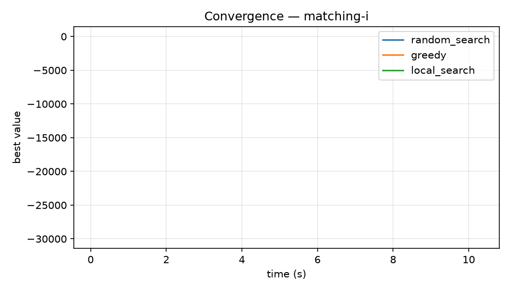
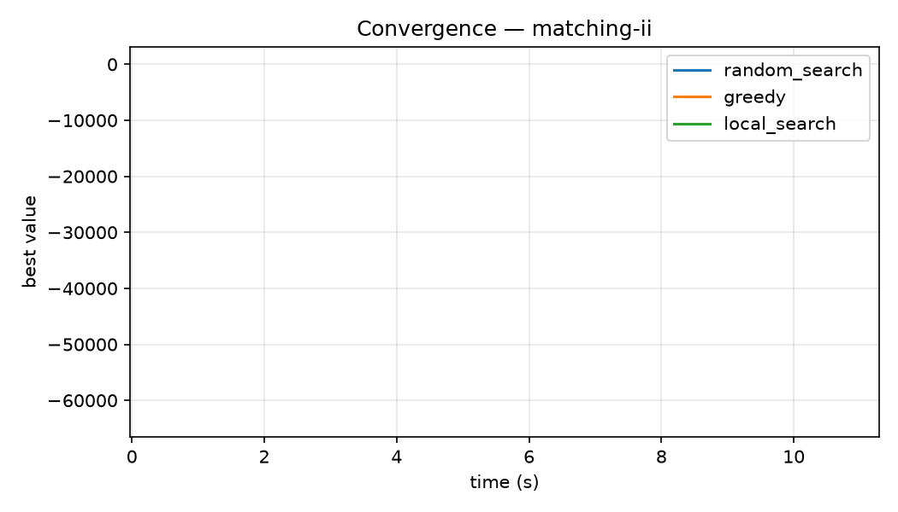
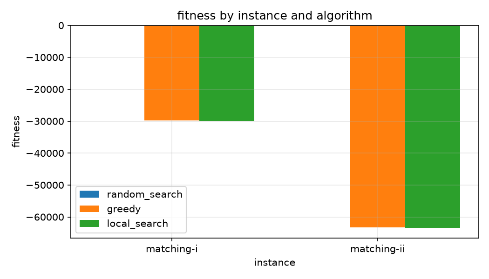
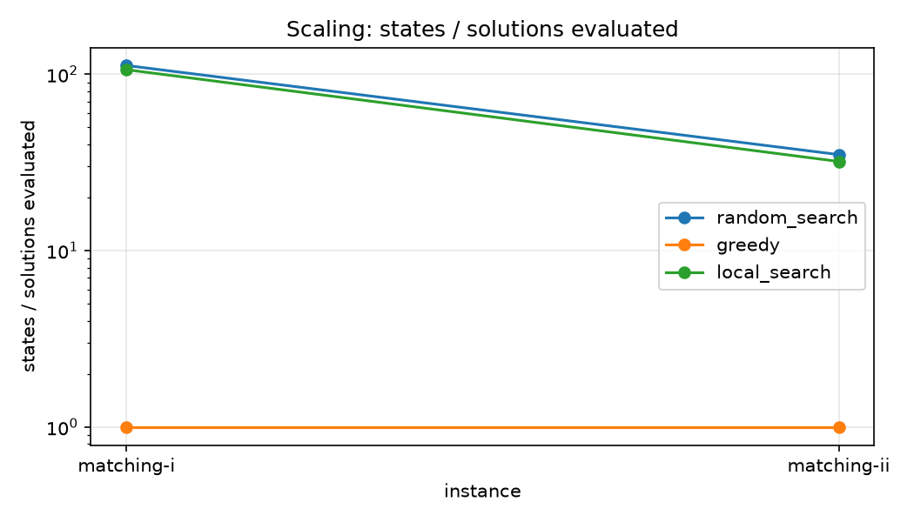
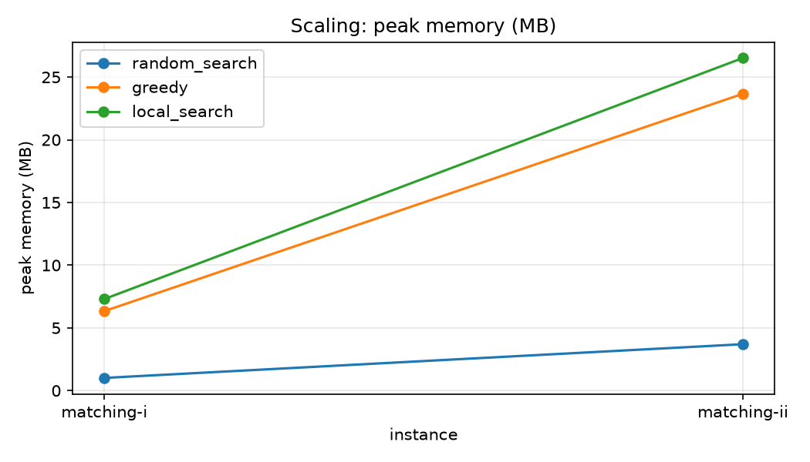
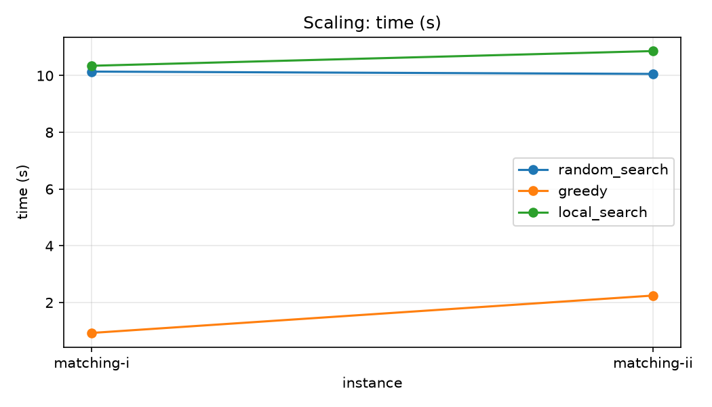

# Luna Tomato Logistics

Algorithm Design & Analysis project, built with [VSI](https://github.com/andikuqi/vsi).
Problem statement: [docs/PROBLEM.md](docs/PROBLEM.md) · Source: https://optimise.esa.int/challenge/spoc-4-luna-tomato-logistics/About

<!-- vsi:status:start -->
**Progress / Progresi:** `█████████████░░░ 78%  (18/23)`  
**Next step / Hapi i radhës:** (Optional) Advanced trajectory-matching problem
<!-- vsi:status:end -->

## Quick start
```
python tasks.py start     # everything at once: data, tests, baseline, charts, report, progress
python tasks.py check     # progress + next step
```

## Report

### 1. Problem definition
<!-- Ready diagrams of the problem and of classic algorithms: docs/DIAGRAMS.md (pictures in docs/diagrams/). -->
<!-- Formal definition in your own words: input, output, constraints, objective. -->

### 2. Complexity of the problem
<!-- Is it NP-hard? Which parts? Why are heuristics / pruning needed? -->

### 3. Data structures

### 4. Algorithms
<!-- One subsection per algorithm: idea, pseudocode, correctness / guarantees, time & space complexity. -->

### 5. Search-space reduction / optimisations

### 6. Experimental methodology
<!-- Machine, sizes, seeds, time budget, metrics. -->

### 7. Results
<!-- The block below is filled automatically by `python tasks.py report` (or `start`). Write your analysis after it. -->
<!-- vsi:results:start -->
_Generated by VSI on 2026-11-22 from `results/metrics.csv`._

| instance | algorithm | seconds | peak_mb | evaluated | pruned | pruned_pct | fitness |
|---|---|---|---|---|---|---|---|
| matching-i | random_search | 10.14 | 1.011 | 112 | 0 | 0 | 0 |
| matching-i | greedy | 0.9283 | 6.338 | 1 | 0 | 0 | -2.979e+04 |
| matching-i | local_search | 10.35 | 7.302 | 106 | 0 | 0 | -2.993e+04 |
| matching-ii | random_search | 10.06 | 3.7 | 35 | 0 | 0 | 0 |
| matching-ii | greedy | 2.246 | 23.67 | 1 | 0 | 0 | -6.331e+04 |
| matching-ii | local_search | 10.87 | 26.52 | 32 | 0 | 0 | -6.339e+04 |







<!-- vsi:results:end -->

### 8. Comparison & scalability (theory vs measured)

Eksperimentet u kryen mbi dy instancat zyrtare: Matching I (25,000 transfere) dhe Matching II (92,103 transfere). Matjet e mëposhtme vijnë nga `results/metrics.csv`; vlerat e transportit janë `-fitness`, sepse vlerësuesi i ESA-s kthen vlera negative për zgjidhjet më të mira.

| Instanca | Algoritmi | Pesha e transportuar | Koha (s) | Memoria maksimale (MB) |
|---|---|---:|---:|---:|
| Matching I | Greedy | 29,791.692 | 0.9283 | 6.338 |
| Matching I | Local Search | 29,928.278 | 10.3467 | 7.302 |
| Matching II | Greedy | 63,313.022 | 2.2459 | 23.670 |
| Matching II | Local Search | 63,392.117 | 10.8651 | 26.524 |

Local Search e përmirësoi peshën e transportuar me **136.586 (rreth 0.46%)** në Matching I dhe **79.095 (rreth 0.12%)** në Matching II. Ky përmirësim erdhi me kosto më të lartë kohore: Local Search përdori rreth 10 sekonda për instancë, ndërsa Greedy përfundoi më shpejt.

Teoria parashikon për Greedy kompleksitet kohor `O(n log n)` për renditjen e transfereve dhe `O(n)` hapësirë. Në matjet tona, numri i transfereve u rrit rreth 3.68 herë nga Matching I në Matching II, ndërsa koha e Greedy u rrit nga 0.9283 në 2.2459 sekonda. Këto dy matje janë në përputhje me rritjen e kostos kur zmadhohet hyrja, por **nuk provojnë vetë** kompleksitetin asimptotik: për një analizë më të besueshme duhen më shumë madhësi instancash dhe përsëritje.

Local Search nis nga Greedy, kërkon zëvendësime 1-me-2 dhe përdor një shortlist prej 35 kandidatësh me kufi kohor. Për këtë arsye, koha e matur afër 10 sekondave pasqyron kryesisht **buxhetin e ekzekutimit**, jo domosdoshmërisht mënyrën si rritet kompleksiteti me `n`. Grafikët `scaling_seconds.png`, `scaling_peak_mb.png` dhe `convergence_matching-i/ii.png` paraqesin matjet dhe ecurinë e algoritmeve.

### 9. Limitations & future work

- **Nuk ka garanci optimumi:** Greedy dhe Local Search janë heuristika. Upper Bound tregon një kufi teorik, por diferenca prej 27.99% (Matching I) dhe 28.98% (Matching II) nuk është provë se zgjidhjet janë po aq larg optimumit.
- **Përmirësim modest:** Local Search përmirësoi Greedy vetëm rreth 0.46% dhe 0.12%; për rezultate më konkurruese duhen eksploruar metoda të tjera dhe parametra të ndryshëm.
- **Eksperimentet janë të kufizuara:** Rezultatet aktuale vijnë nga një konfigurim testimi. Nevojiten disa ekzekutime me farëra rastësore dhe buxhete kohore të ndryshme, si edhe madhësi të tjera hyrjeje.
- **Trajectory Matching ende nuk është zgjidhur:** Përpjekjet e deritanishme prodhuan vlerësim ESA `0.0`. Ende nuk kemi një transfer Tokë–Hënë që përputh orbitën e synuar dhe kufizimet e masës/karburantit.
- **Dorëzimi në ESA mbetet i hapur:** Zgjidhjet për Matching I/II u kontrolluan lokalisht me vlerësuesin zyrtar, por llogaria e platformës ende nuk është funksionale; nuk kemi një pozicion të konfirmuar në Combined Leaderboard.

Puna e ardhshme duhet të fokusohet në optimizim më të fortë për Matching I/II, optimizim të plotë të trajektores dhe dokumentimin e eksperimenteve të përsëritura, përpara se të pretendohet një rezultat konkurrues në renditjen e kombinuar.

### 10. Conclusions
Në këtë projekt u implementuan dhe u krahasuan algoritmet Random Search, Greedy dhe Local Search për problemin Luna Tomato Logistics të ESA-s.

Local Search arriti rezultate më të mira se Greedy në të dy instancat: 29,928.278 në Matching I dhe 63,392.117 në Matching II.

Rezultatet tregojnë se kërkimi lokal përmirëson cilësinë e zgjidhjes, por kërkon më shumë kohë ekzekutimi. Pjesa Advanced mbetet për optimizim të mëtejshëm, pasi ende nuk është arritur transfer i vlefshëm.
### Tools used
- **VSI** (https://github.com/andikuqi/vsi): project structure, official data download, measuring (time, memory,
  states), experiment runner, charts, report skeleton, and *template* diagrams (pipeline, problem model,
  generic algorithm flowcharts).
- **My own work:**- My own work: Greedy, Local Search, Upper Bound,
  experimental analysis and algorithm testing.
- AI assistant used: ChatGPT for coding assistance,
  debugging, documentation and analysis.- AI assistant(s) used: <!-- e.g. Codex / Copilot / ChatGPT, and what for -->

<!-- luna-algorithm-analysis:start -->

## Analiza e algoritmeve — Luna Tomato Logistics

### Modelimi i problemit

Një transfer është një katërshe `(e, l, d, w)`: orbitë rreth Tokës, orbitë rreth Hënës, destinacion, peshë. Zgjidhet një grup transferesh me shumën më të madhe të peshave, duke përdorur secilën vlerë `e`, `l`, `d` maksimumi një herë. Vektori i dorëzimit ka 0/1 për secilin transfer. Vlerësuesi ESA kthen **negativin** e peshës së transportuar, prandaj rezultati më negativ është më i mirë.

### 1. Random Search — baseline i VSI

Ideja: krijon vektorë rastësorë brenda kufijve, i vlerëson me `udp.fitness()` dhe ruan më të mirin.

```text
best <- asnjë
përderisa ka kohë:
    x <- vektor rastësor
    rezultat <- fitness(x)
    nëse rezultat është më i mirë: best <- x
kthe best
```

Kompleksiteti për `k` kandidatë me `n` pozicione: rreth `O(k*n)` kohë (duke supozuar vlerësim `O(n)`); `O(n)` hapësirë për kandidat/best. Ky baseline nuk garanton zgjidhje valide për instanca të mëdha.

### 2. Greedy sipas peshës — `src/algorithms.py`

Ideja: rendit transferet nga pesha më e madhe te më e vogla; zgjedh një transfer vetëm nëse nuk përsërit E, L ose D.

```text
rendit transferet sipas peshës në zbritje
E, L, D <- bashkësi boshe
për secilin transfer t në renditje:
    nëse pesha(t) > 0 dhe asnjë prej E/L/D nuk është përdorur:
        zgjidhe t; shëno E/L/D si të përdorura
kthe transferet e zgjedhura
```

Kompleksiteti: **`O(n log n)` kohë**, për shkak të renditjes; **`O(n)` hapësirë** për indeksat dhe bashkësitë. Greedy nuk garanton optimumin global.

### 3. Local Search (1-nga-2 swap) — `src/algorithms.py`

Ideja: nis nga Greedy. Provon të heqë një transfer dhe të shtojë dy transfere të përputhshme me peshë më të madhe; pas përmirësimeve plotëson hapësirat me transfere pa konflikte. Implementimi ynë kufizon listën në **35 kandidatë për transfer të bllokuar** dhe përdor afat kohor, për ta mbajtur kërkimin praktik.

```text
S <- Greedy(transfers)
përderisa ka kohë:
    për çdo transfer jashtë S, gjej cilat transfere të S e bllokojnë
    kërko dy kandidatë që bllokohen vetëm nga i njëjti transfer i S
    nëse dy kandidatët janë kompatibilë dhe kanë peshë më të madhe:
        hiq transferin bllokues; shto të dy kandidatët
    përndryshe: ndalo
plotëso S me transfere pozitive pa konflikte
kthe S
```

Le të jenë `r` numri i raundeve, `n` numri i transfereve dhe `s` numri i atyre të zgjedhur. Me listë të shkurtuar `k=35`, një kufi i sipërm për secilin raund është `O(n log n + s*k²)` (përfshirë renditjen); në total `O(r*(n log n + s*k²))`, plus kufizimin praktik të kohës. Hapësira është `O(n+s)` për kandidatët dhe bashkësitë. Për shkak të kërkimit lokal nuk ka garanci të optimumit global.

### 4. Upper Bound — `src/upper_bound.py`

Për çdo nyje të Tokës, Hënës dhe destinacion merr peshën më të madhe të një transferi që e përdor atë nyje. Shuma e peshave maksimale për secilin grup jep tre kufij; minimumi i tyre është Upper Bound i sigurt mbi optimumin. Kompleksiteti: `O(n)` për kalimin nëpër transfere, plus nyjet e regjistruara për shumat; hapësira `O(v)`, ku `v` është numri i nyjeve të ndryshme. Kufiri mund të jetë i lirshëm.

### Pse problemi është i vështirë (NP-hard)

Problemi klasik **3-dimensional matching** pyet nëse ekziston një grup prej të paktën `K` triples pa nyje të përbashkëta. Nëse në versionin tonë i japim çdo triple pesha 1, kërkimi nëse pesha optimale arrin `K` e zgjidh edhe problemin klasik. Kështu, problemi i përputhjes tredimensionale me pesha është të paktën po aq i vështirë (**NP-hard**). Për këtë arsye përdorim heuristika për instancat me 25,000 dhe 92,103 transfere; nuk pretendojmë zgjidhje optimale.

### Rezultatet e matura lokalisht

Tabela më poshtë lexohet nga `results/metrics.csv` në momentin e ekzekutimit të këtij skripti. Pesha e transportuar është `-fitness`; nuk janë pikë të Combined Leaderboard.

| Problemi | Algoritmi | Pesha e transportuar | Koha (s) |
|---|---|---:|---:|
| matching-i | random_search | -0.000 | 10.141 |
| matching-i | greedy | 29,791.692 | 0.928 |
| matching-i | local_search | 29,928.278 | 10.347 |
| matching-ii | random_search | -0.000 | 10.060 |
| matching-ii | greedy | 63,313.022 | 2.246 |
| matching-ii | local_search | 63,392.117 | 10.865 |

### Krahasim me Upper Bound

| Problemi | Algoritmi më i mirë i matur | Upper Bound | Dallimi me kufirin |
|---|---:|---:|---:|
| matching-i | 29928.278 | 41561.726 | 27.99% |
| matching-ii | 63392.117 | 89262.551 | 28.98% |

**Kujdes:** Dallimi nga Upper Bound nuk është gabimi real nga optimumi. Advanced (Trajectory Matching) kërkon trajektore fizike të vlefshme; skanimet tona të deritanishme nuk kanë prodhuar pikë pozitive dhe nuk përfaqësojnë një zgjidhje finale.

### Mjetet dhe përgjegjësia e punës

VSI krijoi strukturën dhe baseline-in. Algoritmet Greedy, Local Search dhe Upper Bound u zhvilluan me ndihmën e ChatGPT dhe u testuan në projekt. Studenti duhet të kuptojë e të shpjegojë kodin dhe eksperimentet në prezantim. Rezultatet reale janë ato që raporton skedari `results/metrics.csv`.

<!-- luna-algorithm-analysis:end -->


