# Diagrams — Luna Tomato Logistics

Generated by VSI. GitHub shows the Mermaid blocks as pictures; AI agents read them as text.
PNG versions for the report are in `docs/diagrams/` (`python tasks.py visualize` redraws them).
The algorithm templates are generic: adapt them to **your** algorithm (rename steps, add your pruning / neighbourhood / greedy rule).

## Project pipeline — Luna Tomato Logistics

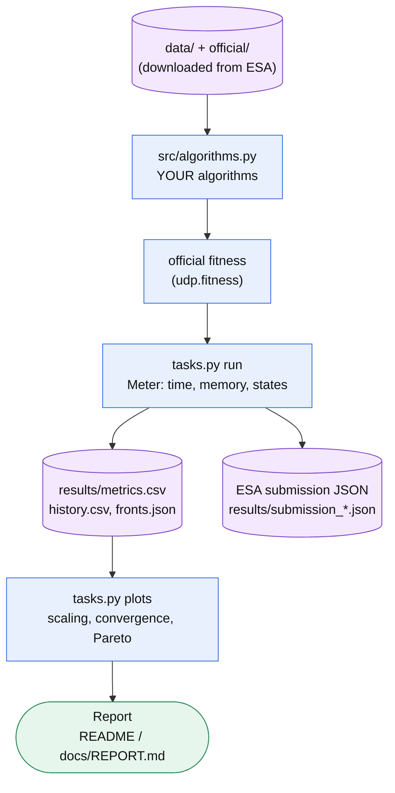

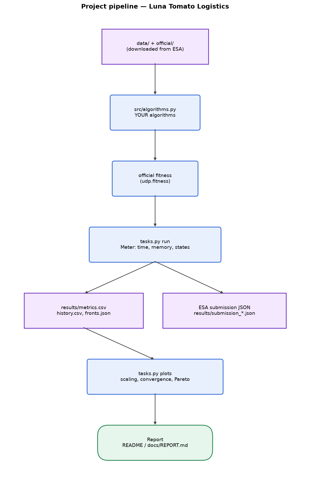

## Problem model — Luna Tomato Logistics (matching)

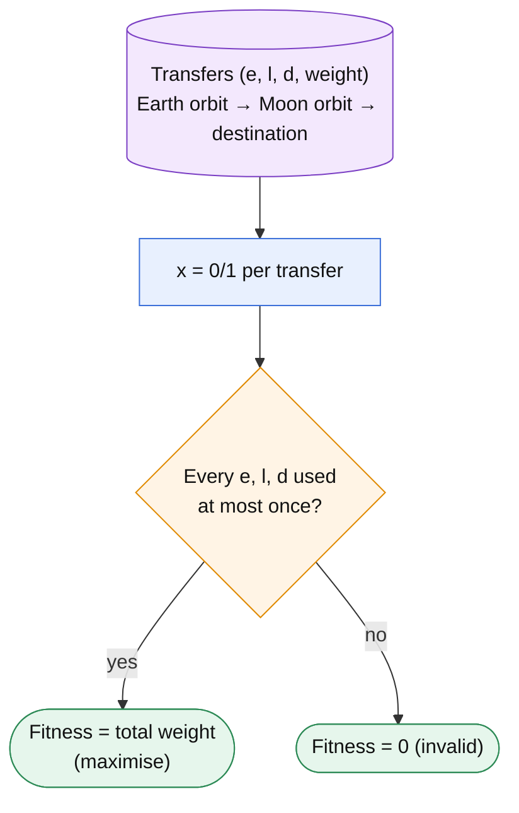

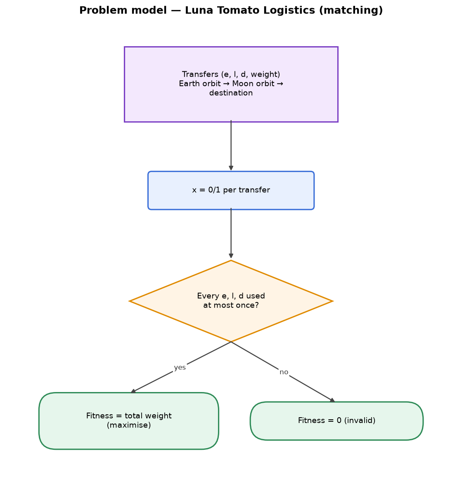

## Greedy (template)

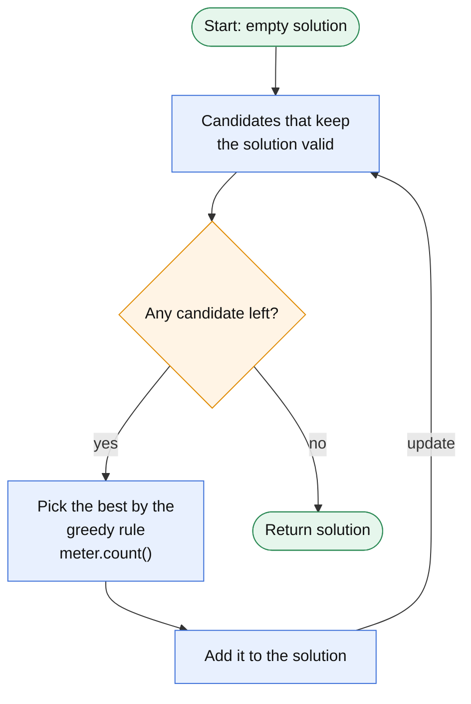

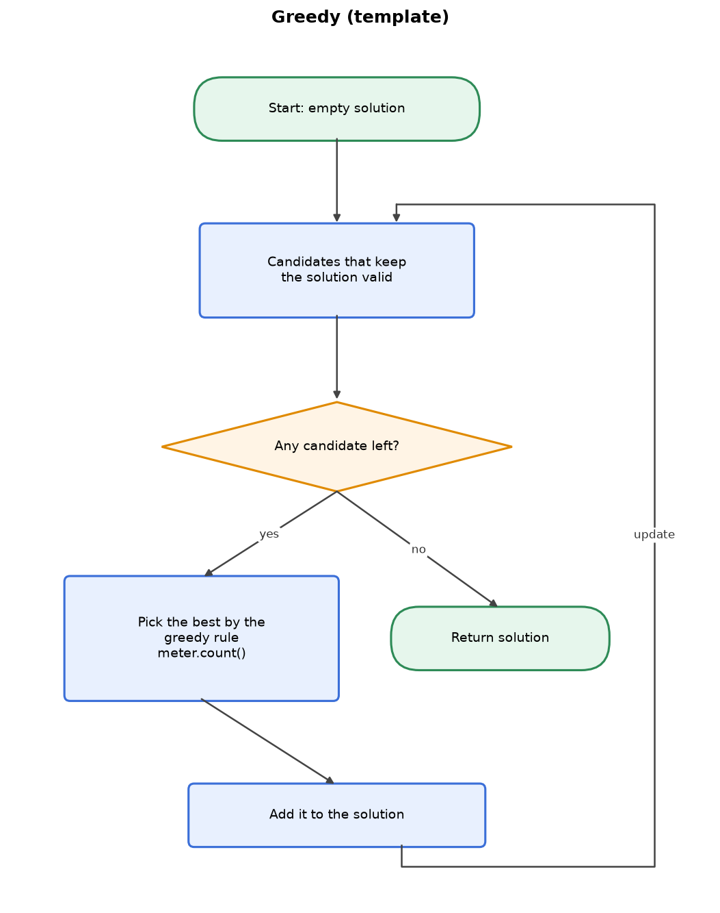

## Local search (template)

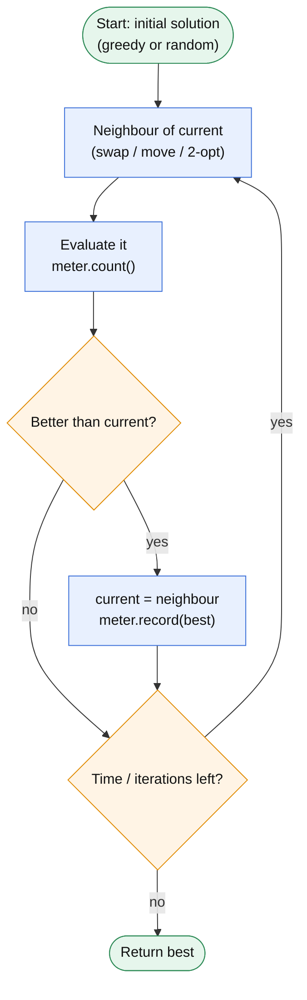

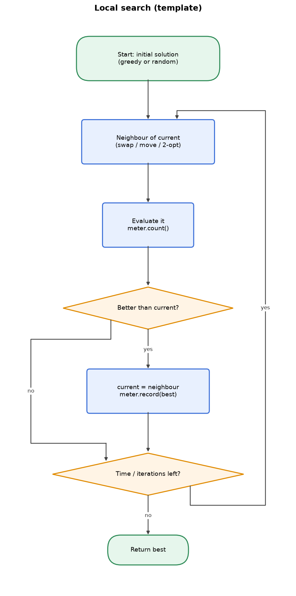

## Simulated annealing (template)

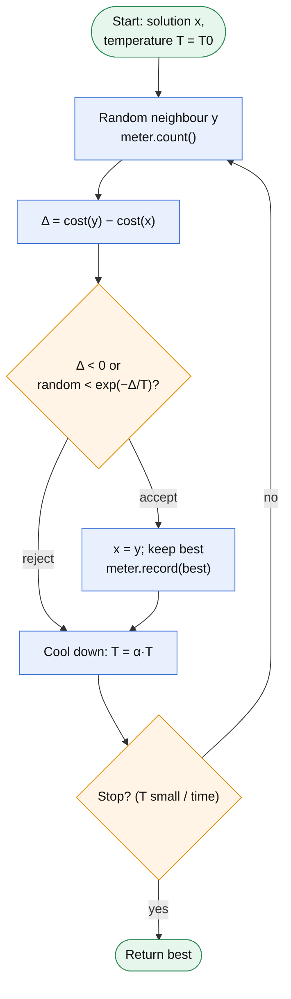

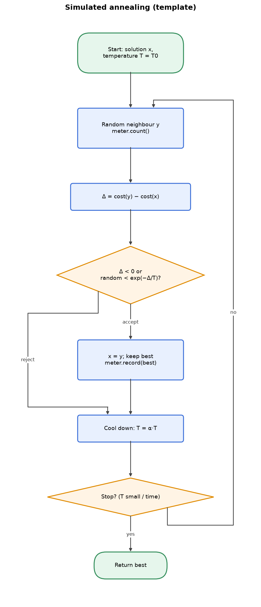

## Genetic algorithm (template)

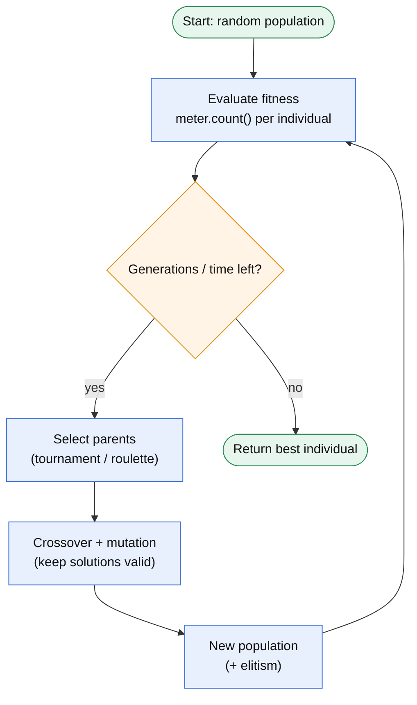

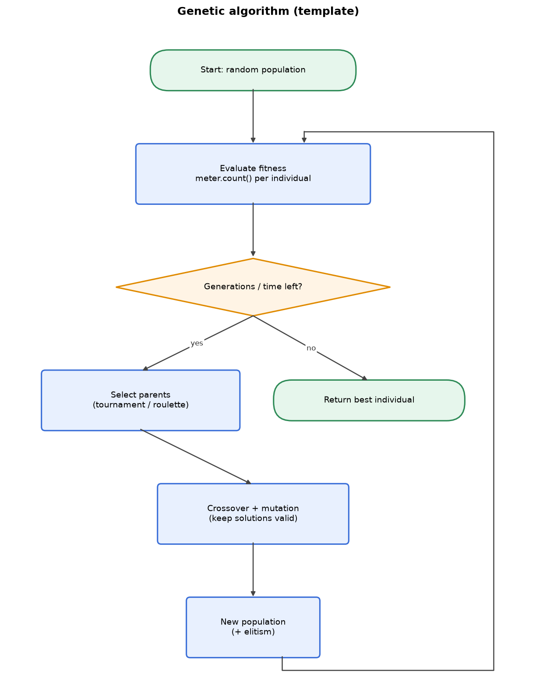

## Branch & bound (template)

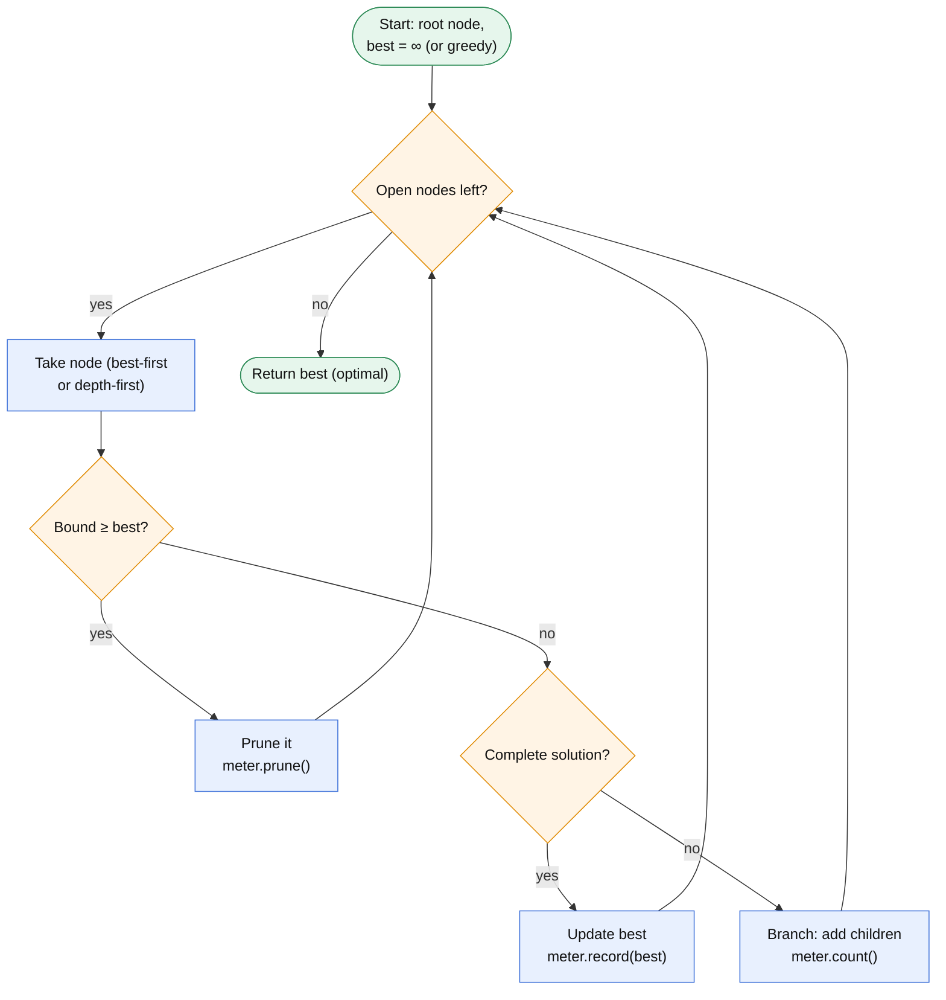

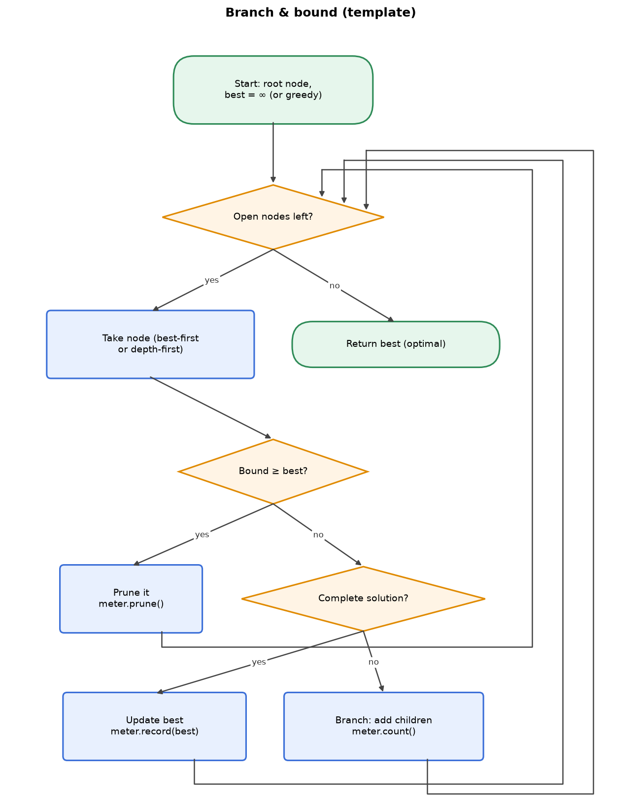

## Dijkstra / A* (template)

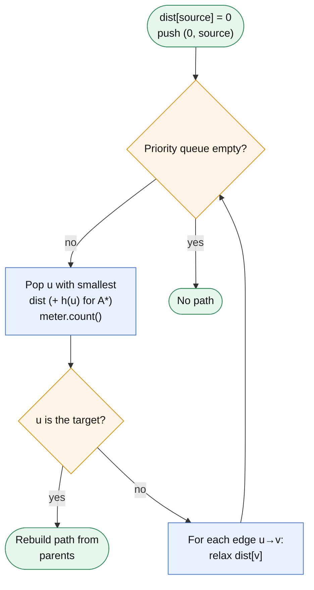

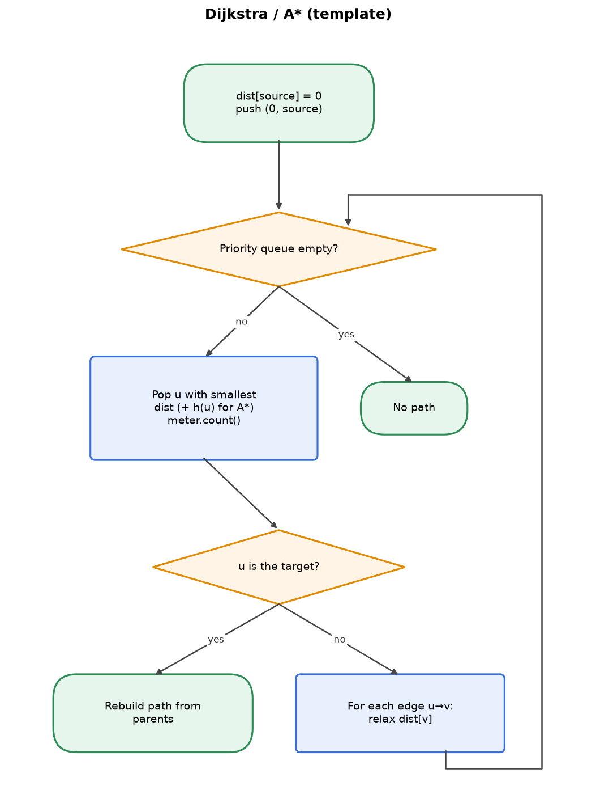

## Instance pictures

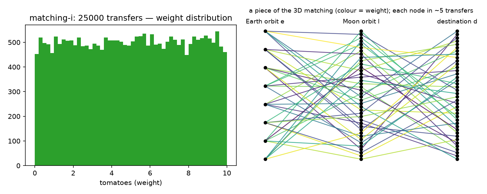

## Make a diagram of YOUR algorithm

```python
from vsi.diagrams import Diagram, Node
d = Diagram("My greedy for <problem>", [
    Node("s", "Start", "round"),
    Node("p", "Pick the vertex with\nthe smallest degree"),
    Node("q", "Vertices left?", "diamond"),
    Node("r", "Return order", "round")],
    [("s", "p", ""), ("p", "q", ""), ("q", "p", "yes"), ("q", "r", "no")])
print(d.mermaid())                       # paste into the README (GitHub draws it)
d.png("docs/diagrams/my_greedy.png")     # picture for the report
```
Shapes: `box` step · `round` start/end · `diamond` decision · `data` input/output.
